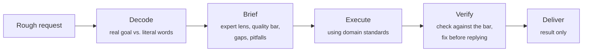

<div align="center">

# 👑 PromptKing

**Type a rough request. Get the result an expert would deliver.**

[](LICENSE)
[](#installation)
[](#benchmarks)

</div>

PromptKing is a Claude Code plugin that upgrades your request *behind the scenes*. It silently turns a rough request into an expert-level brief, carries it out, checks the result against an expert's quality bar, and hands you only the finished work.

You never have to write, read or copy-paste a "better prompt". You just get a better answer.

---

## Before / after

Real output from the [eval suite](#benchmarks), same model, same request. Excerpts are trimmed.

> **Request:** `write readme for my todo app made with react and firebase`

<table>
<tr><th width="50%">Without PromptKing</th><th width="50%">With PromptKing</th></tr>
<tr valign="top"><td>

> Your working directory is empty, so I don't have any project files to base the README on. A couple of options:
>
> 1. If your project lives elsewhere, tell me the path…
> 2. If you just want a solid generic README… quickly confirm: what Firebase services does it use (Auth? Firestore vs Realtime Database? Hosting?), and any notable features…
>
> Which would you like?

</td><td>

> # Todo App
> A fast, minimal todo list app built with React and Firebase…
>
> ## Features · Tech Stack · Quick Start · Configure Firebase · Deploy …
>
> *(complete README)*
>
> `Assumed: Vite as the build tool, Firestore for storage, Email/Password auth, and MIT license — swap these if your stack differs.`

</td></tr>
</table>

**Judge's verdict:** *"The request is clearly actionable as-is… stopping to ask is unnecessary friction. [PromptKing] just delivers a solid, well-structured, accurate README with sensible assumptions clearly flagged."*

---

## How it works



For every request, PromptKing silently answers seven questions: *What is the real goal? What exact deliverable serves it? What would the best practitioner include? What does the context already tell us? What does "excellent" look like here? What's missing, and what's the sensible default? Where does this kind of task usually go wrong?*

It then applies built-in standards for the type of result: **code**, **writing**, **analysis and decisions**, **creative work**, and **prompts for other AIs**.

**Ask or assume.** If every missing detail has a sensible default, PromptKing delivers on those defaults and tells you what it assumed in one line. It asks (at most two questions, each with a suggested default) only when the subject itself is missing, like `write a proposal` with no topic.

---

## Installation

### Option 1: Plugin marketplace (recommended)

In Claude Code:

```
/plugin marketplace add rafay247/promptking
/plugin install promptking@promptking
```

This installs the skill **and** the always-on hook.

### Option 2: Manual

```bash
git clone https://github.com/rafay247/promptking.git ~/promptking
claude --plugin-dir ~/promptking
```

Or copy just the skill (no always-on mode):

```bash
cp -r ~/promptking/skills/promptking ~/.claude/skills/
```

### Option 3: claude.ai

Zip the skill folder and upload it in the Skills section of your claude.ai settings:

```bash
cd skills && zip -r promptking.zip promptking
```

`/promptking <request>` works there too; always-on mode requires Claude Code.

---

## Usage

```
/promptking write a bash script to back up my postgres db every night
/promptking email to client that the project will be 2 weeks late
/promptking postgres or mongodb for my app?
/promptking write a prompt for chatgpt to summarize my meeting notes
```

### Always-on mode

```
/promptking on     # every message gets the PromptKing treatment
/promptking off    # back to normal
```

While on, a `UserPromptSubmit` hook adds a short note to each message telling Claude to apply PromptKing, except to slash commands, short acknowledgements ("ok", "thanks") and answers to Claude's own questions. The setting is a flag file at `${XDG_CONFIG_HOME:-~/.config}/promptking/always-on`, so you can also toggle it by creating or deleting that file. The first toggle may show a permission prompt for that path.

### The `Assumed:` line

When PromptKing fills a gap with a default you might want differently, it ends with one line, for example:

```
Assumed: PostgreSQL 16 on Linux, 7-day retention, local backups only.
```

Reply with a correction and it will adjust. No line means nothing important was assumed.

---

## Benchmarks

PromptKing was tested head-to-head against plain Claude Code on 13 deliberately rough requests (code, writing, analysis, creative, prompt-writing, one ambiguous and one trivial), in two full runs of the same skill version.

| Run | PromptKing wins | Baseline wins | Ties | Win rate (excl. ties) | Behavior checks |
|---|---:|---:|---:|---:|---:|
| Seed 7 | 8 | 1 | 4 | 89% | 13 / 13 |
| Seed 42 | 9 | 3 | 1 | 75% | 13 / 13 |
| **Combined** | **17** | **4** | **5** | **81%** | **26 / 26** |

| Category | PromptKing | Baseline | Tie |
|---|---:|---:|---:|
| Code | 5 | 0 | 1 |
| Writing | 4 | 1 | 1 |
| Analysis | 3 | 0 | 1 |
| Prompts for AI | 2 | 0 | 0 |
| Ambiguous request | 1 | 0 | 1 |
| Trivial request | 1 | 0 | 1 |
| Creative | 1 | 3 | 0 |

**Method**

- Each request runs in a fresh headless Claude Code session (`claude -p`, Claude Code 2.1.220, model `claude-sonnet-5`), once plain and once with `/promptking`, with personal plugins and settings excluded.
- A separate judge call (same model, no skills) compares the two answers blind, in random A/B order, on usefulness, correctness, specificity, fit and judgment on ambiguity.
- Behavior checks: asks only when it should, keeps trivial answers short, never leaks its internal brief.
- Raw outputs, verdicts and summaries are in [`evals/results/`](evals/results/).

**Honest caveats**

- Small sample: 13 cases × 2 runs, one judge model, one answer per case per run. The two runs differ by 14 points, which shows how noisy single samples are.
- The baseline is strong. Plain Claude already answers well; most wins are clear but not dramatic.
- **Creative is a weak spot.** The judge preferred longer brainstorm lists over PromptKing's curated shortlist with a recommended pick, and fewer `[fill-in]` slots in social posts. Contributions welcome.

**Reproduce:**

```bash
python3 evals/run.py --seed 42
```

---

## Design principles

- **Result over prompt.** The improved brief is a means, never the deliverable.
- **Scale to the task.** A one-line question gets a one-line answer; a script gets tests, run steps and a restore command.
- **Deliver on defaults, ask only when blocked.** Assumptions are stated in one line instead of turning into a questionnaire.
- **Verify before replying.** Every result is checked against an explicit quality bar.
- **No invented facts.** Statistics, testimonials and customer names become marked placeholders.
- **Grounded in current guidance.** Built from official vendor guides, without outdated tricks like forced "think step by step" or temperature advice for reasoning models.

---

## Sources

PromptKing's standards are drawn from these guides (fetched and verified November 2026; notes in [`docs/research-notes.md`](docs/research-notes.md)):

- Anthropic: [Prompting best practices](https://platform.claude.com/docs/en/build-with-claude/prompt-engineering/claude-prompting-best-practices) · [Effective context engineering for AI agents](https://www.anthropic.com/engineering/effective-context-engineering-for-ai-agents)
- OpenAI: [Prompt engineering](https://developers.openai.com/api/docs/guides/prompt-engineering) · [Reasoning best practices](https://developers.openai.com/api/docs/guides/reasoning-best-practices) · [GPT-5 prompting guide](https://developers.openai.com/cookbook/examples/gpt-5/gpt-5_prompting_guide)
- Google: [Gemini prompt design strategies](https://aistudio.google.com/docs/prompting-strategies) · [Thinking](https://aistudio.google.com/docs/thinking)
- DAIR.AI: [Prompt Engineering Guide](https://www.promptingguide.ai/)

---

## Project structure

```
promptking/
├── .claude-plugin/        plugin manifest + marketplace
├── skills/promptking/
│   └── SKILL.md           the skill: brief, deliver-or-ask rule, response shape, domain standards
├── hooks/                 always-on UserPromptSubmit hook
├── evals/                 test cases, judge rubric, runner, results
├── tests/                 hook tests
└── docs/                  research notes, baseline observations, design spec and plan
```

---

## Contributing

Issues and pull requests are welcome, especially new eval cases and improvements for creative tasks.

```bash
# unit tests for the eval runner
cd evals && python3 -m unittest test_run

# hook tests
sh tests/test_hook.sh

# add a case to evals/cases.json, then run just that case
python3 evals/run.py --cases your-case-id
```

When changing `SKILL.md`, run the full eval before and after and include both summaries in your PR.

---

## License

[MIT](LICENSE) © 2026 Rafay Shaikh
